# Kayzee XP

A portfolio you walk into. The page opens on a 3D bedroom at dusk; click the old computer and the camera pushes in until the CRT fills the view, where a Windows-XP-style desktop (built in three.js) holds the résumé, projects, music, games and a guestbook.

**Live:** https://kayzee-room.vercel.app/room  ·  desktop only: https://kayzee-xp.vercel.app

Portfolio of Kshitiz "Kayzee" Mittal (PR & communications, content & social media, brand storytelling). Designed and directed by Kayzee, built with Claude Code.

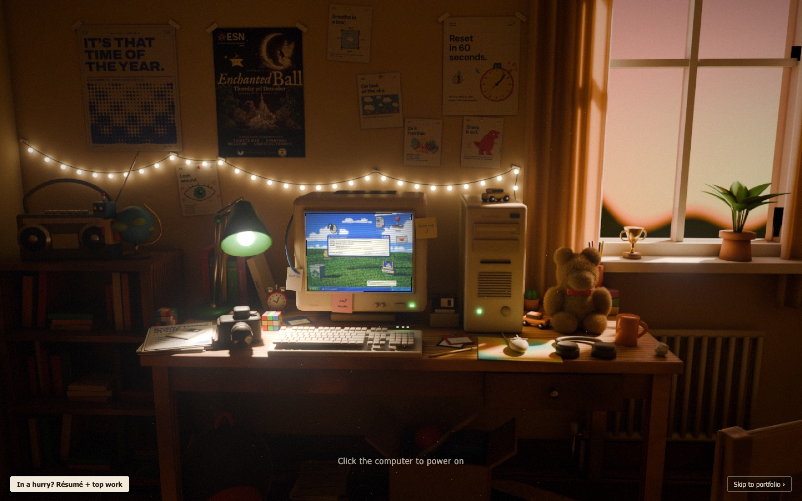

## Watch

| Room tour | Games |
|---|---|
| 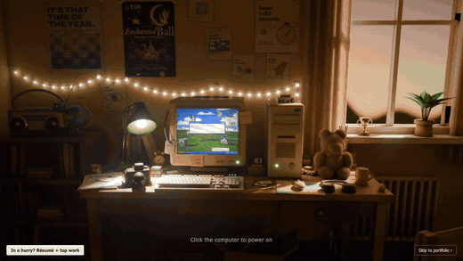 | 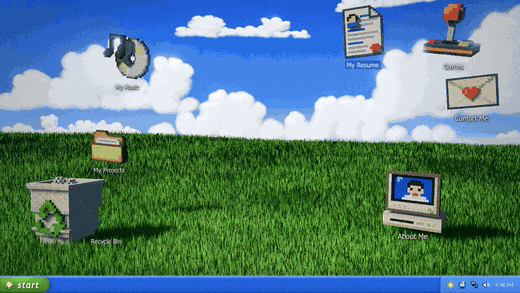 |

Full-quality clips: [`media/video/room-tour.mp4`](media/video/room-tour.mp4) · [`media/video/games.mp4`](media/video/games.mp4) · the rendered push-in on its own: [`media/video/push-in.mp4`](media/video/push-in.mp4)

## What is in it

**The room**
- A film-quality Blender (Cycles) render you can move through: click the computer and a pre-rendered 48-frame push-in carries you to the monitor.
- The live site runs on the monitor glass. Nothing leaves the room.
- Things to click: the boombox plays the playlist on a random track, posters open full size, the lanyard opens the résumé, the lamp switches off, and about two dozen other objects answer back. A counter keeps score of the secrets found.
- "In a hurry?" panel for recruiters: summary, CV download, email, top projects. No booting required.
- Personal links (`/hi/<company>`): the sticky note on the monitor greets that company by name.

**The desktop**
- XP-style shell: boot, login, Start menu, taskbar, draggable windows with soft 3D shadows, voxel icons over a grass hill.
- Résumé viewer, project explorer (projects are embedded Playbook pages behind a made-up address bar), mail form, notepad, paint, recycle bin.
- Music player driven by a Spotify playlist.
- Seven original games: Mines, Solitaire, Pinball, Grass Snake, Inbox Zero, Reversi, Headline Rush.
- Guestbook, a Run box with a few secret commands, time of day (day / sunset / night).
- Admin page: projects, recruiter links, guestbook approval, visit log.

All art, icons, sounds and games are original. No operating-system assets are used.

## How the room works

The room is not lit in the browser. Blender renders it from two viewpoints: the chair (`projA`) and a close-up in front of the monitor (`projB`). In the browser, those two pictures are projected back onto the real room geometry (a 320 KB Draco mesh), so the camera can drift and parallax is real while every pixel is still a Cycles pixel.

Moving between the two viewpoints by re-projection leaves thin seams wherever one object passes in front of another. So the move itself is rendered: 48 frames along the same camera path, played as a two-second film behind the live layers (screen, handwritten notes, fairy-light glow, dust in the sunbeam). The page moves its own camera along the identical path, so those layers stay in register with the film, and the room mesh is drawn depth-only so they are hidden correctly behind furniture.

At the end of the push-in the camera stands exactly where the close-up was rendered, and the live site is laid over the glass as an iframe sized to the projected screen corners.

## Layout

```
site/            the website (static files + serverless functions)
  index.html, main.js, world.js, shell.js, wm.js   XP desktop (three.js r187, plain ES modules, no bundler)
  apps/          one module per window: resume, projects, music, games, guestbook ...
  room/          the room page: room.js, renders, mesh, push-in films, artwork
  api/           serverless functions (site data, contact, Spotify, links, guestbook, visits, admin)
  admin/         admin page
  dev/server.mjs local dev server
room/            Blender build scripts (headless, Python) and textures
media/           snapshots of the build, stage by stage, and demo clips
docs/            design notes
```

## Run it locally

```bash
cd site
node dev/server.mjs        # http://127.0.0.1:7500  (room at /room, admin at /admin)
```

No install step for the front end. Useful query flags: `/?desktop` skips boot and login, `/?open=resume` (or `projects`, `music`, `snake`, `typer` ...) opens a window directly.

## Hosting

Vercel: static files plus functions in `site/api`. One JSON document per data type is kept in Vercel Blob (site content, recruiter links, guestbook, visits). Environment variables: `ADMIN_PASSWORD`, `SESSION_SECRET`, `BLOB_READ_WRITE_TOKEN`; optional `RESEND_API_KEY`, `CONTACT_TO`, `CONTACT_FROM`, `SPOTIFY_CLIENT_ID`, `SPOTIFY_CLIENT_SECRET`.

Project media is not stored here. Projects are public Playbook pages embedded by link; the site keeps only a small thumbnail per project.

## Rebuilding the room

Needs Blender 5.x. The scene is fully procedural: no `.blend` file is required.

```bash
cd room
python3 gen3.py                                             # assembles build_room3.py
BLENDER=/Applications/Blender.app/Contents/MacOS/Blender
$BLENDER --background --factory-startup --python build_room3.py -- preview my-label   # quick look
$BLENDER --background --factory-startup --python build_room3.py -- final              # projA, projB, lamp-off, mesh, room.json
$BLENDER --background --factory-startup --python build_room3.py -- path               # the 48 push-in frames
```

Look used for the published version: `EXPO=0.0 FILL=1.6 AMB=0.012 AMB_COL=0.45,0.55,0.85 SUN=20 FAIRY=9 LAMP=75 SKY=1.5`.

## Build log in pictures

From first blockout to the current room. All 38 stages are in [`media/snapshots`](media/snapshots).

| | | |
|---|---|---|
| 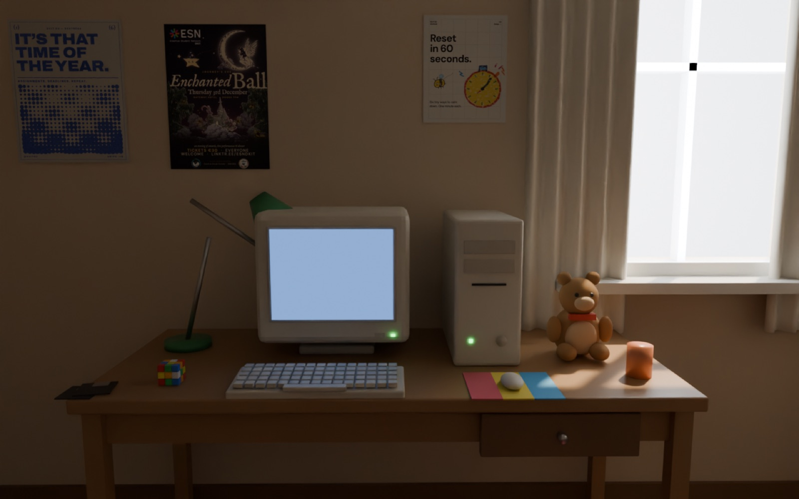 Blockout | 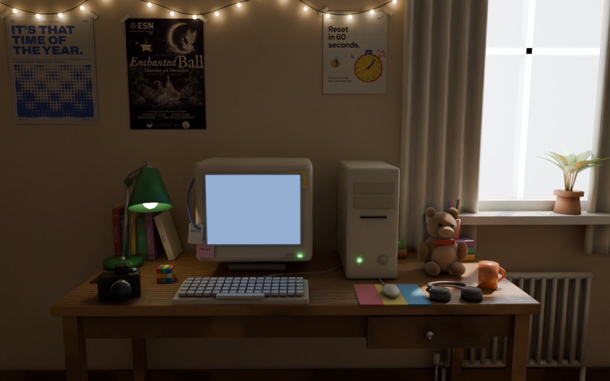 Real materials | 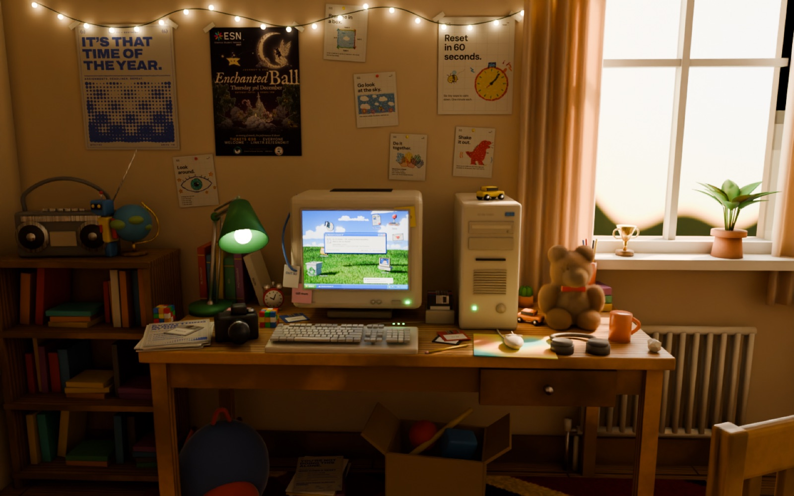 Golden hour |
| 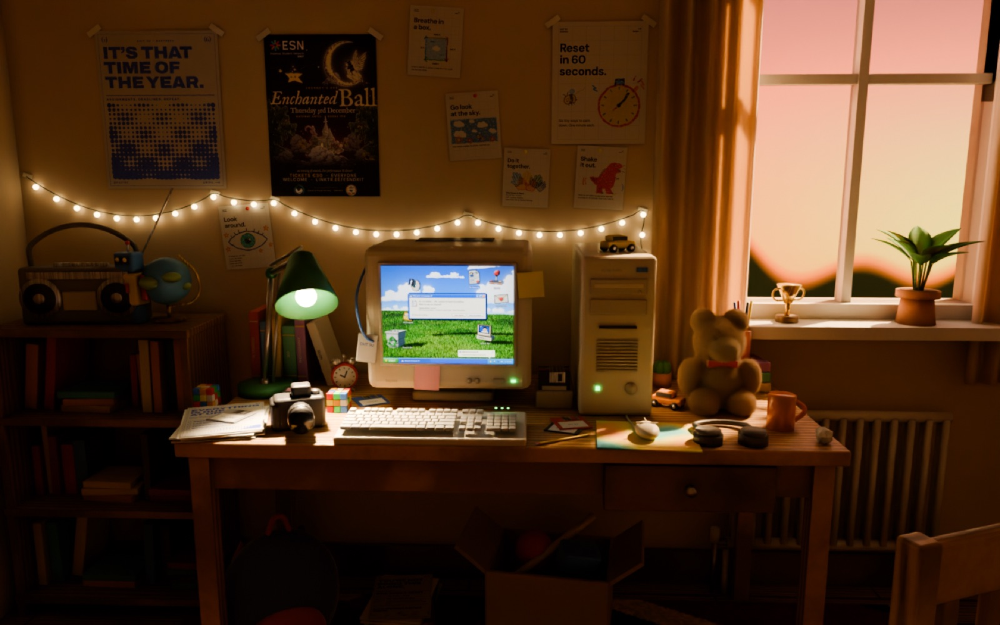 Dusk, lights lowered | 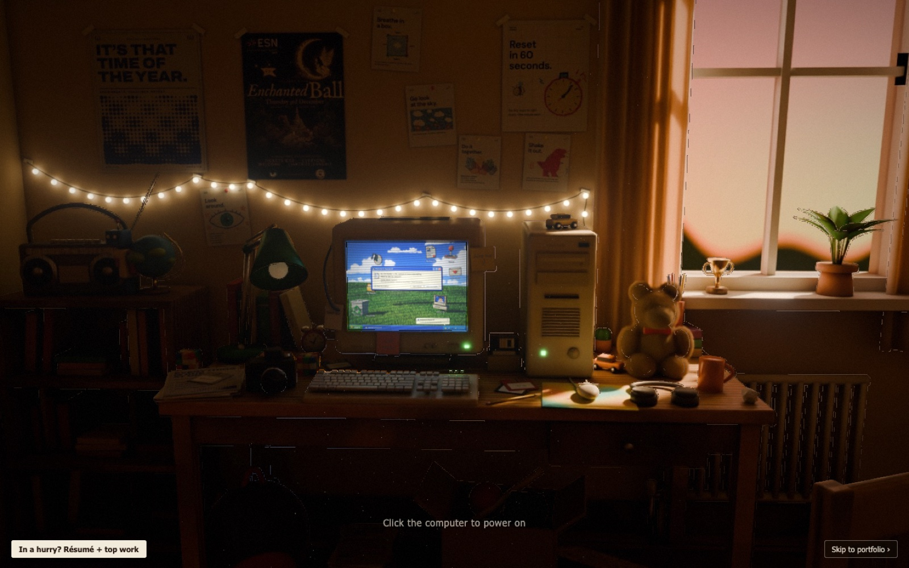 Lamp off | 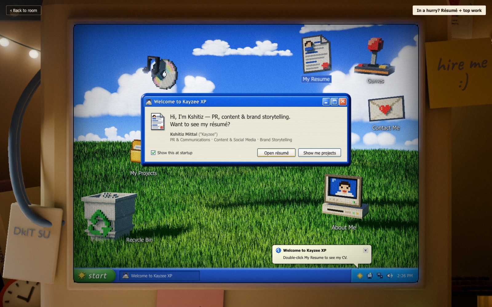 Live site on the glass |
| 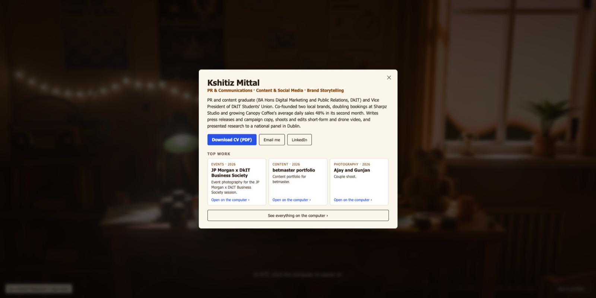 Fast lane | 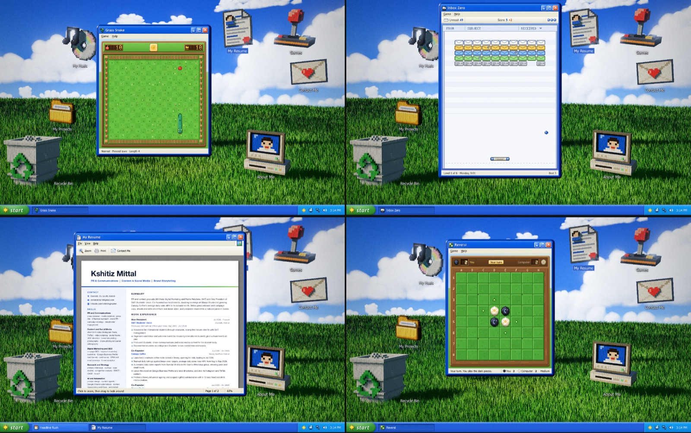 New games | 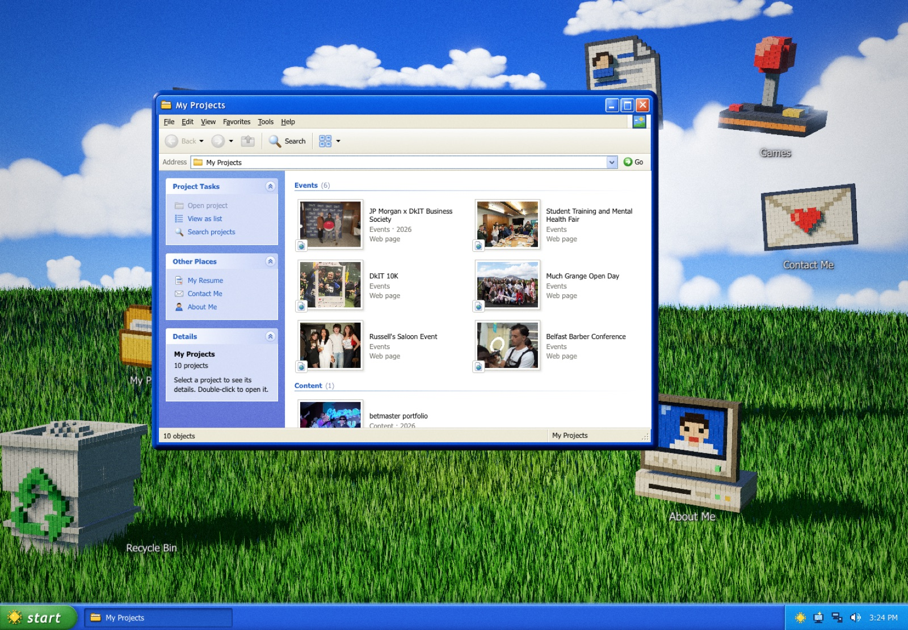 Projects |
